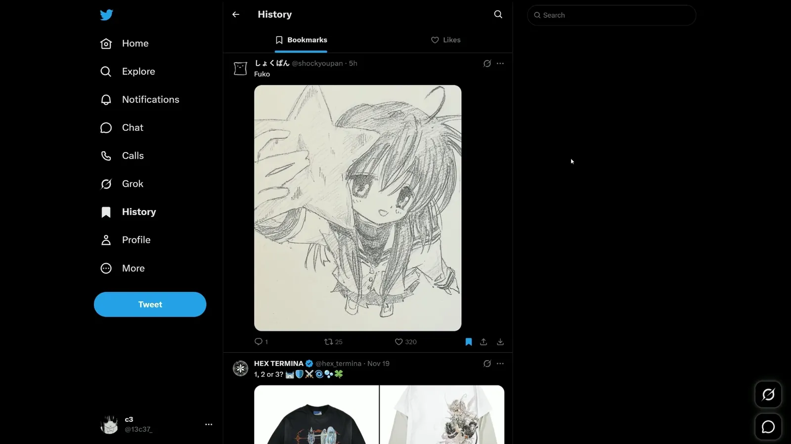

**Maintained continuation of furyu's *Twitter 原寸びゅー* (Twitter View Original Images)**, which was discontinued and removed. Earlier forks (Coxxs) are no longer updated for X's changes.

Demo artwork: @shockyoupan, @hex_termina

### What's new compared to older versions
- Works with posts that have **up to 20 photos** (older versions only picked up ~6)
- Viewer opens instantly with a loading indicator
- Redesigned settings: dark / light / auto theme, everything on one screen
- Optional post button that matches X's own icons (off by default)
- Lighter on the page: batched scans instead of running on every DOM change

### Usage
- **Click** a photo → all originals on one page
- **Alt + click** → one image per page
- **Shift + click** → download the selected image
- In the viewer: **j** / **k** next / previous · **d** download · **z** zip · **s** size · **b** background · **esc** close
- Settings: userscript manager menu → **settings**

### Credits
Original author: **furyu** ([website](https://memo.furyutei.com/) · [support furyu](https://memo.furyutei.com/about#send_donation)). Versions 0.1.17–0.1.22 by Coxxs. Maintained by 13c37.

Source & bug reports: [github.com/13c37/twOpenOriginalImage](https://github.com/13c37/twOpenOriginalImage)
