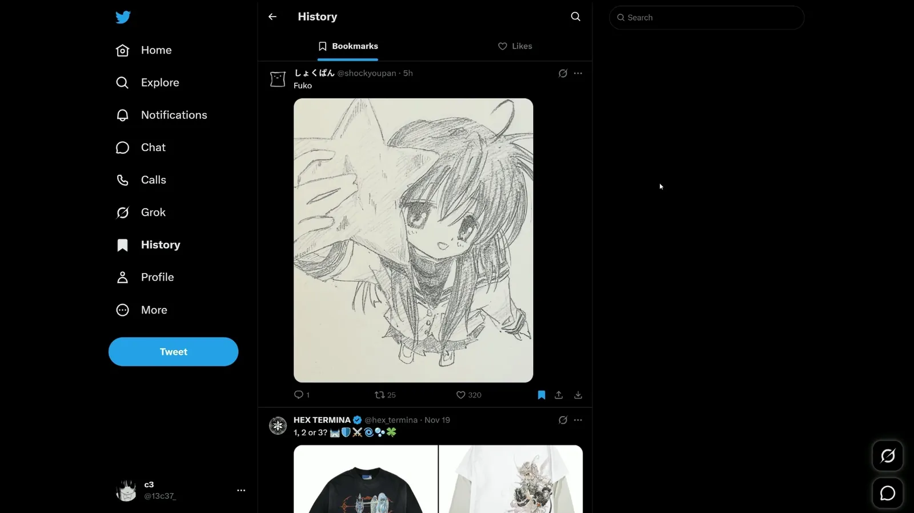
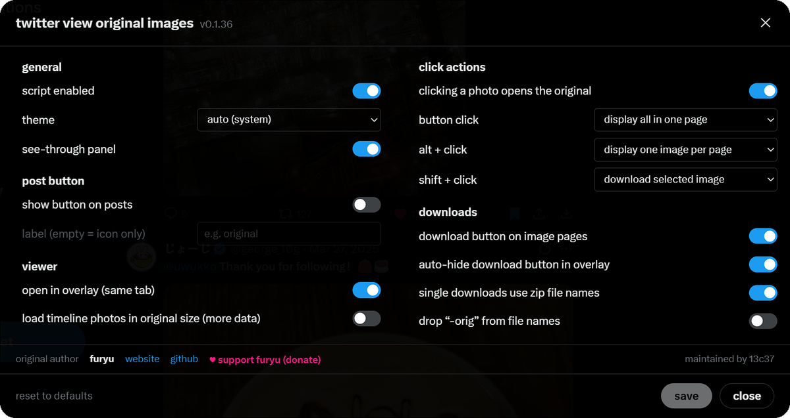

# twOpenOriginalImage

Open and save images from X (Twitter) in original size (`name=orig`). Works on posts with up to 20 photos.

Demo artwork: [@shockyoupan](https://x.com/shockyoupan), [@hex_termina](https://x.com/hex_termina).

**Actively maintained.** Continuation of furyu's *Twitter 原寸びゅー* (twOpenOriginalImage), which was discontinued at 0.1.16.

## Install

1. Install a userscript manager: [Violentmonkey](https://violentmonkey.github.io/), [Tampermonkey](https://www.tampermonkey.net/) or [ScriptCat](https://docs.scriptcat.org/en/).
2. Install the script from **[Greasy Fork](https://greasyfork.org/en/scripts/606352-twopenoriginalimage)** or directly from GitHub: [twOpenOriginalImage.user.js](https://github.com/13c37/twOpenOriginalImage/raw/main/twOpenOriginalImage.user.js)

Updates arrive automatically through your userscript manager.

## Usage

Click any photo in a post (or enable the icon button under *Post button* in Settings):

| Action | Default |
|---|---|
| All images on one page | Click |
| One image per page | <kbd>Alt</kbd> + Click |
| Download selected image | <kbd>Shift</kbd> + Click |

In the viewer: <kbd>j</kbd> / <kbd>k</kbd> next / previous · <kbd>d</kbd> download · <kbd>z</kbd> zip · <kbd>s</kbd> size · <kbd>b</kbd> background · <kbd>esc</kbd> close.

Settings: userscript manager menu → **settings**. Theme (dark / light / auto) is under *General*.

## Bugs

Open an [issue](https://github.com/13c37/twOpenOriginalImage/issues) with the post URL and your browser + userscript manager.

## Changelog

### 0.1.37
- Viewer and download buttons use X's font, matching the settings window and post button.

### 0.1.36
- Viewer opens immediately with a loading indicator; the clicked photo loads first. Much faster on posts with many photos.
- Classic compact viewer bar restored.
- Interface text is lower case throughout.
- Fixed: mouse wheel over the viewer could scroll the page behind it.

### 0.1.35
- Fixed: settings content overlapping the title bar and buttons when *see-through panel* is on.

### 0.1.34
- Faster viewer: photos decode in the background and the clicked photo is loaded first.
- Loading spinner bundled with the script.

### 0.1.33
- Greasy Fork no longer shows a donation link to the maintainer; furyu's link stays in Credits and settings.

### 0.1.32
- Uses `@match` instead of `@include` (https only).

### 0.1.31
- Removed the obsolete TweetDeck match.

### 0.1.30
- Post button is off by default and shows only an icon unless a label is set. Clicking a photo opens the original.

### 0.1.28
- Fixed: post button stayed highlighted after closing the viewer.
- New option: see-through settings panel.

### 0.1.27
- On opened posts, the button sits in the action bar next to reply / repost / like.

### 0.1.26
- Post button and settings follow X's look (font, colours, switches); settings laid out in two columns.

### 0.1.25
- Settings fit on one screen with clearer names; obsolete TweetDeck options hidden.
- Lower CPU use: page scans are batched instead of running on every page change.

### 0.1.24
- New settings window with dark / light / auto theme. Click outside or press <kbd>Esc</kbd> to close.

### 0.1.23
- Supports posts with up to 20 photos.

### 0.1.17 – 0.1.22 (Coxxs)
- `x.com` support, layout fixes, configurable click actions, `name=orig` URL handling.

### ≤ 0.1.16 (furyu)
- Original script.

## Credits

- **[furyu](https://github.com/furyutei)** — original author (2016–). Donations: <https://memo.furyutei.com/about#send_donation>
- **Coxxs** — maintained 0.1.17–0.1.22
- **13c37** — current maintainer (0.1.23+)

## License

[MIT](LICENSE). Original copyright © 2016 furyu; bundled libraries keep their own notices (see the script header).
